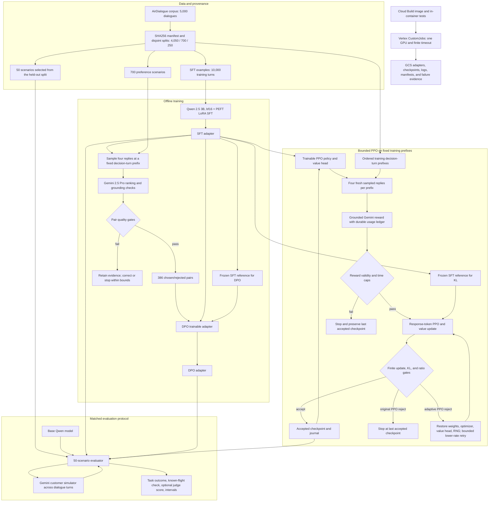

# RLAIF project report

## Executive summary

This project is a flight-booking dialogue agent trained with reinforcement learning from AI feedback (RLAIF). The original university repository contained a completed SFT run, experimental hand-written PPO and REINFORCE-style loops, Gemini-based simulation and judging, and historical logs, but it was not a coherent or reproducible implementation. The rebuild turned the work into a gated pipeline with immutable data provenance, PEFT SFT, Gemini preference generation, DPO, bounded PPO, adaptive PPO, identical held-out evaluation, cloud artifacts, and explicit failure evidence.

The final comparison is measured on the same 50 held-out scenarios. Base, SFT, and DPO task success were 16%, 26%, and 34%; PPO checkpoint 19 was 38%; adaptive PPO at 50 cumulative accepted updates was 34%. These results are directional because the evaluation set is small and the confidence intervals overlap. Cloud work was bounded by a predeclared internal cost cap. The outcome tables below summarize the recorded experiment artifacts without exposing private cloud resource identifiers.

After the training closeout, the four adapters were integrated into a local,
localhost-only simulator with deterministic tools and authoritative transaction
outcomes. A separate 50-scenario-by-four-adapter MPS matrix completed with 100%
task completion and displayed-response validation for every arm; rejected model
candidates were safely replaced and reported as fallbacks. The final release
passed 340 local tests, 85 rebuild tests, and the versioned release gate. See
`RLAIF_2_RELEASE_REPORT.md` for those local-system results. They measure the full
guarded application and should not be conflated with the historical policy-only
rates above.

## 1. Initial goal

The initial goal was to build a flight-booking dialogue agent for the AirDialogue corpus, train a language model with supervised fine-tuning, and improve its behavior with AI-generated feedback rather than human annotators. The intended loop used a language model as the customer simulator, Gemini as the judge, and a policy optimizer such as PPO or a direct-RLAIF variant. The original README advertised preference generation and DPO, although the implementation did not contain a pair builder or DPO trainer.

The later rebuild goal was more concrete: recover the useful parts of the university work, make the pipeline runnable and auditable, produce a preference dataset, train SFT and DPO adapters, run a matched base/SFT/DPO evaluation, and add a bounded PPO extension. Every expensive cloud stage had to use one GPU, finite timeouts, durable artifacts, and a cost gate. The original architecture was documented in a historical source audit.

## 2. What was already done before the rebuild

Before the rebuild, the repository already contained:

- A 20,000-example, two-epoch SFT artifact logged on two A100s, with reported `train_loss` 0.6219 and final logged loss 0.5161.
- Historical PPO runs of 15, 43, and 10 episodes, with mean judge scores of 2.60, 1.88, and 2.40 out of 10.
- A hand-written PPO trainer with a value head and a separate REINFORCE-with-learned-baseline implementation.
- Gemini-based customer simulation and judge prompts, a flight knowledge base, transcripts, offline records, plots, and Vertex AI logs.
- Cloud Dockerfiles and Vertex-oriented execution artifacts.

Those artifacts were evidence of real prior work, but they were not a clean baseline for new experiments. The audit records that the historical PPO entry point contained a `NameError`, the PPO KL term was not a true reference-model KL, the reference model was loaded but unused in the historical PPO path, and no DPO trainer or preference-pair dataset existed in the original tree despite README claims. The two algorithm paths duplicated and drifted rather than sharing a package. These are historical findings, not descriptions of the rebuilt implementation.

## 3. Gaps found at handoff

The important gaps were:

1. **Runnable correctness:** the historical PPO path was broken at rollout time.
2. **Algorithm correctness:** historical PPO did not use a true frozen reference KL and had weak provenance around the reference checkpoint.
3. **Missing DPO path:** there was no actual chosen/rejected pair pipeline or DPO trainer in the original repository.
4. **Data and evaluation controls:** splits, held-out isolation, source immutability, and evaluation protocol identity were not enforced centrally.
5. **Operational controls:** cloud jobs lacked the later checkpoint, retry, resume, timeout, and budget discipline.
6. **Reproducibility:** historical model loading did not pin a Hugging Face repository revision, and the original SFT log did not match the committed training script’s hardware/configuration details.
7. **Repository structure:** scripts were siloed, flat imports were fragile, cloud manifests and source layout were coupled, and historical evidence was mixed with supported entry points.
8. **Scientific interpretation:** small runs and inconsistent evaluation paths did not support broad claims about quality or generalization.

## 4. What we decided to do and how

The project was rebuilt in stages behind explicit gates.

First, preserve the historical tree and logs as provenance. Create a supported package under `rebuild/rlaif`, centralize data loading and split validation, and record SHA256 hashes for the corpus, splits, and derived SFT examples. Refuse to train or evaluate if those artifacts change.

Second, use a staged pipeline. The source corpus has 5,000 dialogues; a deterministic split with seed 20260922 assigns 4,050 to SFT, 700 to preference generation, and 250 to held-out evaluation. The SFT split yields 10,000 training-turn examples. The final evaluator selects the same 50 scenarios from the held-out partition for every arm. Split overlap is checked and the source, split, and derived SFT files have SHA256 manifests.

1. Build and test a container.
2. Run a bounded SFT pilot, inspect it, then run full one-epoch PEFT SFT.
3. Generate preference pairs from a disjoint pair-generation split, using deterministic decision-turn selection, stochastic candidate sampling, and Gemini judging. Require yield, score-gap, distinctness, parsing, and stability gates.
4. Train DPO from the validated pairs and frozen SFT reference.
5. Evaluate base, SFT, and DPO on the same held-out 50-scenario protocol.
6. Add PPO as a bounded extension. Start from SFT, use a genuine frozen-SFT reference, on-policy rollouts, bounded reward retries, durable checkpoints, atomic rollback, hard KL/ratio/reward-drop gates, and an incremental cost cap.
7. Evaluate PPO policies with the identical held-out protocol.
8. Reorganize the source tree, build a fresh post-restructure image, run the full in-container tests, document limitations, and obtain an independent high-reasoning review.

The implementation is organized around data provenance, bounded training, a common evaluation protocol, and preserved run evidence.

## 5. What we did and how

### End-to-end architecture

### Package responsibilities

- `rebuild/rlaif/shared/data.py` loads the corpus, validates SHA256 manifests, loads committed splits, rejects overlap, and builds prompt messages.
- `rebuild/rlaif/shared/prompts.py` defines the policy/system prompt and KB rendering.
- `rebuild/rlaif/data/` creates or validates SFT data and splits.
- `rebuild/rlaif/preferences/gen_pairs.py` chooses reproducible decision turns, samples candidate replies, records prompts and token lengths, calls the judge, validates ranking evidence, supports bounded semantic correction, and writes resumable journals.
- `rebuild/rlaif/preferences/parse_ranking.py` and `rank_rubric.py` define the pair-ranking contract and parser.
- `rebuild/rlaif/rewards/ppo_reward.py` grounds PPO rewards against the KB and drops invalid judge evidence rather than inventing a reward.
- `rebuild/rlaif/training/sft_qwen.py` performs PEFT SFT and checks dataset provenance.
- `rebuild/rlaif/training/dpo_qwen.py` validates pairs, uses the SFT adapter as trainable policy, and keeps a frozen copy of that SFT adapter as reference.
- `rebuild/rlaif/training/ppo_qwen.py` implements bounded on-policy PPO with frozen-SFT reference log probabilities, response-token-only losses, value head, ratio/KL gates, reward ledgers, and checkpoints.
- `rebuild/rlaif/training/ppo_qwen_adaptive.py` continues from checkpoint 19 with lower learning rates, fresh batches, atomic rollback, and bounded retries. The original trainer stopped when its hard ratio gate rejected update 20; rollback and retry were introduced in the separate adaptive trainer.
- `rebuild/rlaif/evaluation/eval_qwen.py` runs the identical held-out protocol for each arm, persists scenario-level state, validates customer consent against known offers, and aggregates outcomes.
- `rebuild/cloud/` contains container construction, job preparation, artifact synchronization, identity checks, and archival cloud configurations.

### Engineering decisions and recovery

| Observed problem | Decision and mechanism | Result |
|---|---|---|
| The corpus's pre-rendered flight table omitted fields needed for factual checks; the original dialogues also lacked explicit outcome markers. | Render the raw flight knowledge base and derive a final outcome marker from labeled actions, with limits on marker-bearing training turns. | The policy and evaluator could use consistent flight facts and a machine-checkable outcome contract. |
| Early preference dry runs failed yield or ranking-quality gates. | Move to a decision-turn ranking protocol, validate grounded evidence, and allow bounded semantic correction while retaining raw traces. | Full generation yielded 386 validated pairs from 700 scenarios. |
| Full preference generation hit its time limit after a durable 550-scenario checkpoint. | Resume from the recorded checkpoint with a bounded remaining workload and preserve the uncheckpointed-tail accounting. | All 700 scenarios were processed without treating the partial run as complete. |
| Early evaluation attempts exposed invalid simulator consent and a missed known-flight offer format. | Add bounded semantic repair and extend offer parsing, then rerun the same held-out protocol with fresh output prefixes. | All final model arms completed the same 50 scenarios. |
| Initial PPO lost two rewards to transient judge rate limits; another attempt projected beyond its finite timeout. | Add durable bounded API retries and use measured throughput to stop a run that could not finish in time. | Failure evidence and stable checkpoints were preserved. |
| A later PPO update produced a likelihood ratio of 6.275, beyond the hard limit of 4.0. | Reject that update and retain checkpoint 19. A separate adaptive continuation used lower learning rates, one PPO epoch, atomic rollback, and bounded retries. | The adaptive path accepted 31 more updates to reach 50 cumulative updates; both checkpoints were evaluated independently. |
| The first adaptive evaluation config contained a duplicate adapter flag. | Correct the config, add a regression check, and rerun with the same final adapter. | The corrected evaluation completed all 50 scenarios; the failed attempt remains documented. |

Each recovery used a fresh run identity or an explicitly compatible resume. A failed gate remained visible in the run record rather than being rewritten as a successful stage.

### Training and evaluation controls

The SFT run used one A100 in the rebuilt pipeline, 625 steps, one epoch, and PEFT LoRA. Preference generation used 700 scenarios and retained 386 pairs after gates. Full DPO used three epochs over those pairs. PPO used one A100, hard reference/update KL and likelihood-ratio limits, a 10% semantic reward-drop abort gate, finite rollouts/judge/token/time caps, and atomic checkpoints. Evaluation used the same 50 held-out scenarios and protocol v3 for all final arms.

### Cloud and artifact flow

Cloud Build creates versioned container images after dependency and test checks; the published digest identifies the exact image. Vertex AI CustomJobs execute bounded training or evaluation. Each job writes logs, usage ledgers, run metadata, manifests, checkpoints, and scenario artifacts to GCS. Failed or superseded jobs were retained in their original prefixes. The dated JSON files remain parameter records and provenance; new executions must use fresh preparation outputs and image tags after the restructure.

## 6. What has been done now

Completed work includes:

- Rebuilt package structure under `rebuild/rlaif/` with shared data, preference, reward, training, evaluation, and test modules.
- Immutable dataset manifest and disjoint split validation.
- PEFT SFT training and artifact upload.
- Preference generation with bounded Gemini retries, semantic validation, correction traces, and full gate evidence.
- DPO pilot and full DPO training using the validated 386-pair dataset.
- Matched 50-scenario base/SFT/DPO evaluation.
- Bounded PPO to checkpoint 19, followed by an adaptive continuation to 50 cumulative accepted updates.
- Matched PPO checkpoint-19 and adaptive PPO evaluations.
- Fresh post-restructure image `qwen:20261009-v14`; its build passed 85 in-container tests, including PyTorch PPO tests.
- Updated README, project overview, final results, status, reproducibility, and closeout documentation.
- Independent technical review; the documented remaining limitation is the unpinned historical Hugging Face training revision.
- No active GCP experiment is required for the completed results. GCS remains the evidence store.

## 7. Results and interpretation

### Training results

The [training curves](figures/training_losses.svg) and
[PPO diagnostics](figures/ppo_diagnostics.svg) are generated from the completed
run logs. Their [provenance and limitations](figures/README.md) are documented
alongside the figures.
The [preference outcome](figures/preference_generation.svg) and
[DPO training pair-accuracy](figures/dpo_pair_accuracy.svg) charts show the
intermediate quality checks without treating them as held-out results.

| Stage | Measured result | Artifact |
|---|---:|---|
| SFT | 625 steps; loss 0.86527; 4,659.58 seconds | `runs/20261008-sft` |
| Preference generation | 386 pairs from 700 scenarios; 55.14% yield; all gates passed | `runs/20261008-pairs-full-pro` |
| DPO pilot | 20 steps; loss 0.68082; 384.84 seconds | `runs/20261008-dpo-pilot` |
| Full DPO | 72 steps; loss 0.62709; 1,379.40 seconds | `runs/20261008-dpo` |
| PPO checkpoint 19 | 19 accepted updates; early-stopped before update 20 | `runs/20261009-ppo-v3/checkpoint-0019` |
| Adaptive PPO | 31 additional accepted updates; 50 cumulative; 5,994.14 seconds | `runs/20261009-ppo-adaptive-v4` |

### Matched evaluation results

The [task-success chart](figures/evaluation_task_success.svg) shows all five
arms with Wilson 95% intervals on the same 50-scenario protocol.
The [judge-score chart](figures/evaluation_judge_score.svg) shows the second
reported evaluation metric.

| Arm | Task success | Wilson 95% interval | Mean judge score | Booking success | Explicit unknown-flight ID rate |
|---|---:|---:|---:|---:|---:|
| Base | 8/50 (16%) | 8.3–28.5% | 2.94 | 4% | 0% |
| SFT | 13/50 (26%) | 15.9–39.6% | 2.54 | 0% | 0% |
| DPO | 17/50 (34%) | 22.4–47.8% | 2.58 | 0% | 0% |
| PPO checkpoint 19 | 19/50 (38%) | 25.9–51.8% | 1.92 | — | 0% |
| Adaptive PPO update 50 | 17/50 (34%) | 22.4–47.8% | 2.46 | — | 0% |

Interpretation:

- DPO is the strongest result among the base/SFT/DPO arms on task success: +18 percentage points over base and +8 over SFT. The intervals overlap, so the result is promising directional evidence rather than proof of a general improvement.
- PPO checkpoint 19 has the highest observed task-success rate, but its interval overlaps the other arms. The policy was gate-early-stopped, so it should be described as a 19-update accepted policy.
- Adaptive PPO reached the intended 50 cumulative accepted updates, but its 34% task success was below checkpoint 19’s 38% on this sample. This does not establish that the shorter checkpoint is generally better; the comparison is small and paired.
- Mean judge score did not move monotonically with task success. Booking success was 4% for base and 0% for SFT and DPO; the reported PPO rows do not include that metric. These outcomes should be analyzed by scenario type before making a broad quality claim.
- All final arms recorded zero explicit unknown-flight IDs. This detector only checks explicit flight-ID mentions against the known-flight set; it is not a complete hallucination metric.
- Adaptive PPO had 10 dropped semantic rewards out of 124 attempts (8.06%), below the 10% gate. One unsafe update was rolled back and accepted on a lower learning rate. Maximum accepted frozen-reference KL was 0.03719, update KL 0.01505, and ratio 3.357, all below hard gates.
- Budget controls used conservative reservations; an internal forecast should not be presented as measured billing spend.

## 8. Remaining gaps and why

1. **Historical model revision is not pinned.** The historical runs named `Qwen/Qwen2.5-3B-Instruct` without recording a Hugging Face commit. Evaluation recorded the resolved revision, but exact from-scratch reproduction of historical training is not guaranteed. New preparation requires an immutable revision.
2. **Evaluation power is limited.** Each final arm has only 50 scenarios, and the Wilson intervals overlap. More held-out scenarios and repeated seeds are needed for a reliable claim.
3. **Gemini is part of the measurement loop.** Simulator and judge availability, retries, model behavior, and token caps can affect results. A fixed judge model/version and multiple independent judges would strengthen the study.
4. **The unknown-flight metric is narrow.** It detects explicit flight IDs, not every factual, constraint, or conversational error. Broader grounded factual metrics and human review would add coverage.
5. **PPO was deliberately bounded.** The adaptive run reached 50 accepted updates, but its policy did not improve the measured task-success rate over checkpoint 19. More training would require a new cost decision and a predeclared experimental design; it should not be inferred from the present run.
6. **Cloud billing is separate from experiment controls.** The run records contain conservative reservations. A billing export is required to state actual dollar spend.
7. **Historical and rebuilt artifacts are not byte-identical.** Historical cloud JSONs preserve parameters and provenance, but their normalized module commands must not be run against old flat-layout images. Reproduction requires a newly prepared image and fresh artifact prefix.
8. **The university project’s original multi-GPU SFT source is absent.** The historical log reports two A100s and a configuration that does not match the committed script. The rebuilt SFT run is the authoritative rebuilt measurement for this closeout.

## Evidence map

The reported numbers come from the completed run metrics and evaluation summaries. The repository's internal experiment records retain job IDs and private artifact locations; this public report uses run names instead. Implementation details can be inspected in `rebuild/rlaif/shared`, `preferences`, `rewards`, `training`, and `evaluation`.
