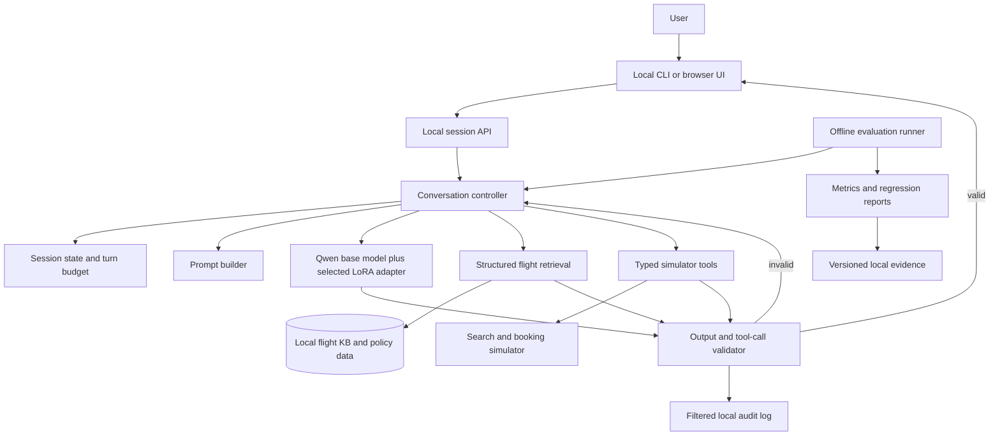

# Local grounded conversation system specification

## 1. Purpose

This specification defines the local application that turns the RLAIF training
artifacts into a usable flight-dialogue assistant. The application is a local,
tool-using conversational agent. It answers flight questions, searches a local
flight knowledge base, and runs a deterministic booking simulator. It does not
make real airline transactions.

The design keeps model generation, retrieval, tools, validation, and evaluation
separate so that each policy adapter can be compared under the same environment.
The first release targets a single user on one laptop or workstation. GCP is
not required at runtime.

## 2. Goals and non-goals

### Goals

- Provide a CLI and local browser conversation interface.
- Load the base Qwen model with one of the SFT, DPO, PPO-checkpoint-19, or
  adaptive-PPO adapters.
- Ground flight answers in a local structured knowledge base.
- Maintain conversation state across turns.
- Validate model outputs and tool calls before showing or executing them.
- Make simulated search and booking deterministic and reproducible.
- Run the existing held-out scenarios locally as regression evaluations.
- Compare adapters on task success, grounding, tool correctness, and latency.

### Non-goals for the first release

- Real airline or payment transactions.
- Multi-user hosting or public internet exposure.
- Autonomous multi-agent workflows.
- Cloud inference or cloud telemetry.
- Training inside the application.
- Treating retrieval as a substitute for evaluation or runtime validation.

## 3. User experience

The user starts a local process and opens `http://localhost:8000`, or uses the
CLI. They can select an adapter, enter a flight request, answer clarification
questions, inspect search results, and run a simulated booking. The interface
must show when an action is simulated and should expose a reset-session control.

Example flow:

1. User asks for a flight from New York to Chicago tomorrow.
2. The controller identifies missing constraints and asks a concise question.
3. The agent calls local flight search with a typed request.
4. The tool returns only records from the local knowledge base.
5. The agent presents valid options and asks for a selection.
6. The simulator validates the selected flight and returns a booking result.
7. The guardrail checks the response before it reaches the UI.

## 4. End-to-end architecture

The controller owns the loop. The model proposes text or a typed action; it does
not directly mutate state. Retrieval supplies grounded context. Tools perform
deterministic actions. Validators are the final authority on whether a tool call
or response can be shown.

## 5. Components

### 5.1 Local UI and API

The first UI should be a small local web application with a streaming response,
conversation history, adapter selector, reset button, and visible simulator
status. A CLI remains useful for smoke tests and debugging. The API should expose:

- `POST /sessions`
- `POST /sessions/{id}/messages`
- `POST /sessions/{id}/reset`
- `GET /health`
- `GET /adapters`

The API must bind to localhost by default. Public binding requires an explicit
configuration switch and a separate security review.

### 5.2 Conversation controller

The controller maintains the current user goal, collected constraints, selected
flight, tool results, and turn count. It runs a bounded loop:

1. Validate the incoming message.
2. Build a prompt from the state and retrieved context.
3. Generate a response or structured action.
4. Parse and validate the action.
5. Execute an allowed tool, or return text.
6. Update state and enforce the turn limit.

The controller must reject unknown actions, repeated tool loops, missing required
fields, and attempts to book a flight not returned by the current search.

### 5.3 Model runtime

The runtime loads the base Qwen model and a selected PEFT adapter. It should
support GPU, CPU fallback, and a quantized local profile. Model revision and
adapter hashes belong in the run metadata. Generation settings are explicit and
recorded per session or evaluation run.

The adapter choices are configuration, not separate code paths:

- `sft`
- `dpo`
- `ppo_checkpoint_19`
- `ppo_adaptive_50`

The runtime should fail clearly when a requested adapter is missing or incompatible
with the base model.

### 5.4 Retrieval and grounding

The initial flight environment should use structured lookup rather than a vector
database. Filters cover origin, destination, date, time, airline, price, and
availability. Policy documents can use keyword or hybrid retrieval if needed.

Every returned record carries a stable local ID. The prompt includes only the
retrieved records needed for the current turn. The response validator checks that
flight IDs and prices mentioned by the model are present in the retrieved context.

If the knowledge base grows substantially, add a hybrid index: structured filters
for transactional fields plus lexical/vector retrieval for policy text. Retrieval
must remain auditable and deterministic for evaluation.

### 5.5 Simulator tools

Use typed functions with explicit schemas:

- `search_flights(criteria) -> FlightSearchResult`
- `get_flight(flight_id) -> Flight | NotFound`
- `hold_flight(flight_id, passenger) -> HoldResult`
- `book_flight(hold_id) -> BookingResult`
- `cancel_booking(booking_id) -> CancellationResult`

The first release may implement only search and simulated booking. Tools must be
idempotent where practical, reject invalid IDs, and never call external systems.

### 5.6 Guardrails

Guardrails operate before and after model generation:

- Input length and prompt-injection screening.
- Typed action schema validation.
- Known-flight and retrieved-context grounding checks.
- Booking-state and passenger-field validation.
- No unsupported claims about payment, confirmation, or real reservations.
- Turn, token, tool-call, and retry limits.
- Sensitive-data filtering in logs.
- Safe fallback text when a response fails validation.

Guardrails should fail closed for transactional actions and fail soft for ordinary
conversation by asking the model to restate an unsupported answer with grounded
information.

## 6. Evaluation plan

The existing 50-scenario protocol becomes a local regression suite. Each scenario
uses the same environment, seed, knowledge base snapshot, and adapter-specific
configuration. Store scenario-level records locally with prompts redacted where
needed.

Required metrics:

- Task success and Wilson interval.
- Search and booking tool-call validity.
- Grounded flight-ID precision.
- Unsupported-claim rate.
- Conversation completion and turn count.
- Mean judge score, clearly labeled as judge-dependent.
- Latency: time to first token and time to completed action.
- Memory and tokens per session.
- Guardrail rejection and recovery rates.

Run unit tests for parsers, tools, state transitions, and guardrails. Run smoke
tests for every adapter. Run the full held-out suite before changing the default
adapter. Keep evaluation artifacts separate from interactive logs.

## 7. Local deployment profiles

### Laptop CPU

Use a quantized model, short context, and low concurrency. This profile is for
functional testing and demos; latency may be high.

### Apple Silicon or local GPU

Use GPU or unified-memory inference with the selected quantized profile. This is
the recommended personal-use profile.

### Workstation

Use the higher precision adapter and longer context when memory permits. Add a
local queue only if multiple users or evaluation workers share the machine.

All profiles should use the same controller, retrieval, tools, and guardrails.

## 8. Security and privacy

Bind locally by default and do not log raw credentials or unnecessary passenger
data. Keep model and dataset paths configurable. If real personal data is ever
introduced, add retention, deletion, access control, and encryption requirements
before use. A local-only deployment reduces exposure but does not remove the need
for input and log hygiene.

## 9. Effort estimate

- CLI inference and simulator: 0.5–1 day.
- Local web UI and adapter selection: 1–2 days.
- Retrieval, typed tools, and guardrails: 1–2 days.
- Evaluation harness and regression reports: 1–2 days.
- Packaging, quantization profiles, tests, and documentation: 1–3 days.

The first usable local release is approximately 4–7 focused engineering days.
A polished local product with installer, Docker profile, and broader performance
testing is approximately 1–2 weeks.

## 10. Acceptance criteria

The local release is ready for a controlled demo when:

- A fresh environment starts the CLI and UI from documented commands.
- Every adapter loads or produces a clear compatibility error.
- Search and simulated booking reject invalid flight IDs.
- Guardrail and tool tests pass.
- The 50-scenario regression suite completes and writes a reproducible report.
- README instructions state hardware requirements and simulator limitations.
- No external network or GCP dependency is required at runtime.
