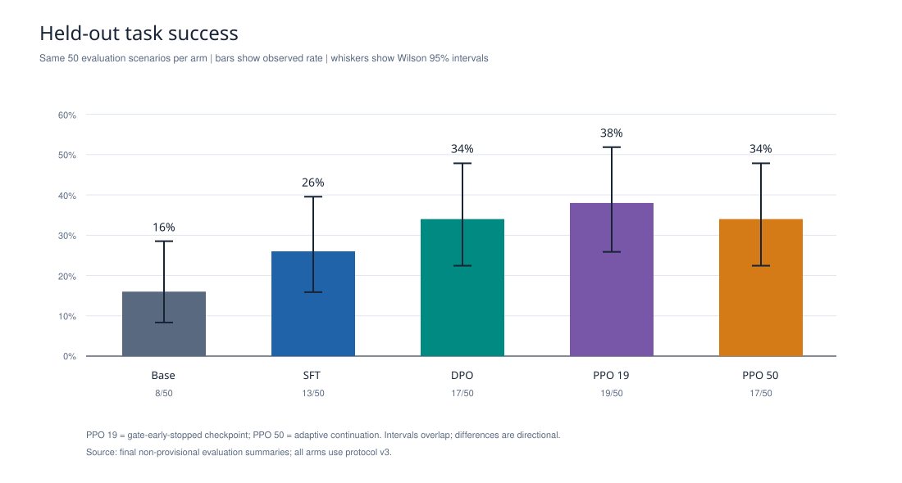
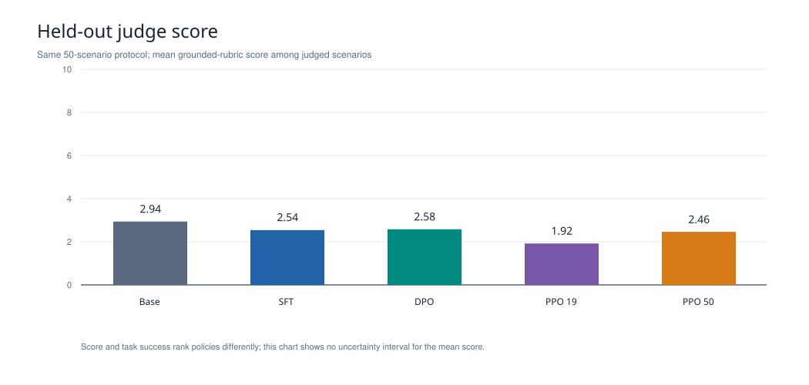
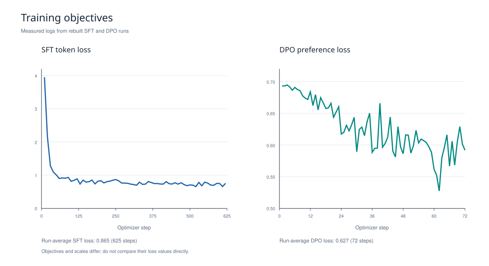
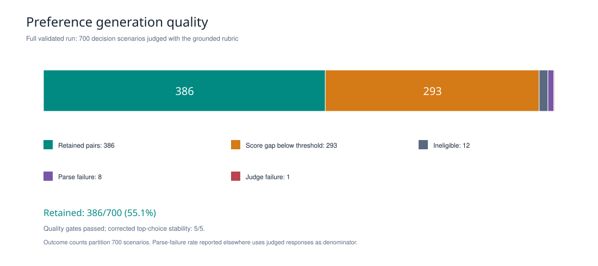
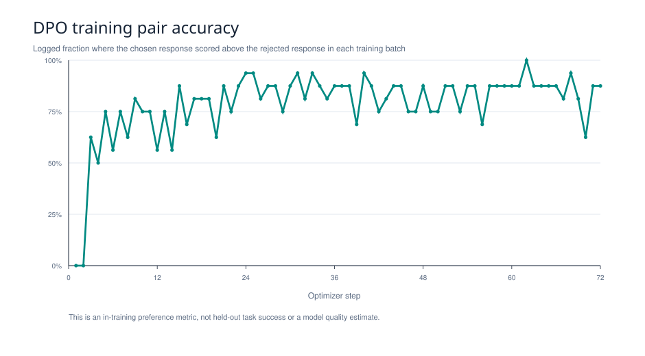
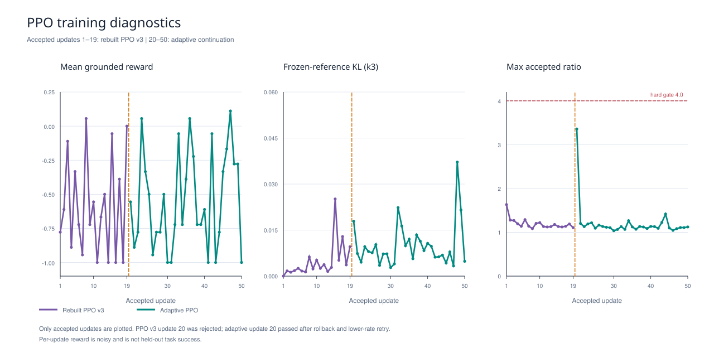

# RLAIF flight-booking agent

This repository contains the supported RLAIF implementation and preserved
historical experiments. Start with [PROJECT_OVERVIEW.md](PROJECT_OVERVIEW.md)
for architecture, measured results, artifact provenance, and limitations.

The supported package is `rebuild/rlaif`:

- `shared/` loads immutable data splits and prompts.
- `data/` prepares training data.
- `preferences/` generates and validates AI preference pairs.
- `rewards/` contains grounded PPO rewards and bounded judge retries.
- `training/` contains PEFT SFT, DPO, PPO, and adaptive PPO.
- `evaluation/` contains the common held-out evaluation runner.
- `tests/` contains CPU and configuration tests.

Cloud job JSON files under `rebuild/cloud/` preserve the experiment arguments,
resource limits, historical image tags, and GCS prefixes. Their command fields
were normalized to the reorganized `rlaif.*` module paths, so they are archival
parameter records rather than byte-for-byte submission manifests and cannot run
against the historical flat-layout images. Generate a fresh config, image tag,
and artifact prefix with the preparation tools below. Historical code and logs
under `baseline/` and `vertex_ai_logs/` are retained for provenance and are not
supported entry points.

The checked-in `rebuild/artifacts/dataset_manifest.json` records SHA256 hashes for
the corpus, split file, and SFT examples. Training and evaluation refuse changed
corpus/split inputs. Historical runs did not pin a Hugging Face model commit;
new closeout preparation requires `--model-revision` and records the resolved
revision when the model loads. See [REPRODUCIBILITY.md](rebuild/cloud/REPRODUCIBILITY.md).

## Local checks

From the repository root:

```sh
PYTHONPATH=RLAIF/rebuild python3 -m unittest discover \
  -s RLAIF/rebuild/rlaif/tests -p 'test*.py'
```

The cloud image runs the same suite with its PyTorch environment. The local
environment must have PyTorch installed to run the PPO tensor tests.

## Cloud jobs

Use `rebuild/cloud/prepare.py` and
`rebuild/cloud/prepare_ppo_adaptive.py` to generate isolated configs in a new
output directory. These scripts only generate files; they do not submit jobs.
For final post-restructure metadata and a fresh image context, use
`rebuild/cloud/prepare_closeout.py` with a new v14-or-later tag, suffix, and
pinned model revision. Submit only bounded JSON configs after checking the
budget ledger in `rebuild/cloud/budget.json`.

Final measured results and GCS locations are documented in
`rebuild/cloud/FINAL_RESULTS.md` and `PROJECT_OVERVIEW.md`.

## Results at a glance

All five final policies used the same 50 held-out scenarios. The observed task
success rates are directional because their 95% intervals overlap. PPO 19 is
the last accepted checkpoint before the original trainer's update gate stopped
the run; PPO 50 is the completed adaptive continuation.



The judge score provides a second view of the same evaluations; it does not
rank the policies in the same order as task success.



The curves below come from the rebuilt runs' saved training logs. SFT and DPO
optimize different objectives, so their loss values should not be compared to
each other. PPO reward is an on-policy training signal, not held-out task success.



The preference quality gates retained 386 of 700 scenarios as training pairs.
DPO's in-training pair accuracy is shown separately from held-out task success.







See [figure provenance and regeneration](figures/README.md) for source files,
checks, and limitations.
